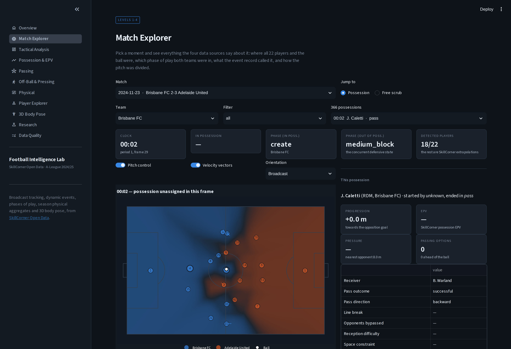
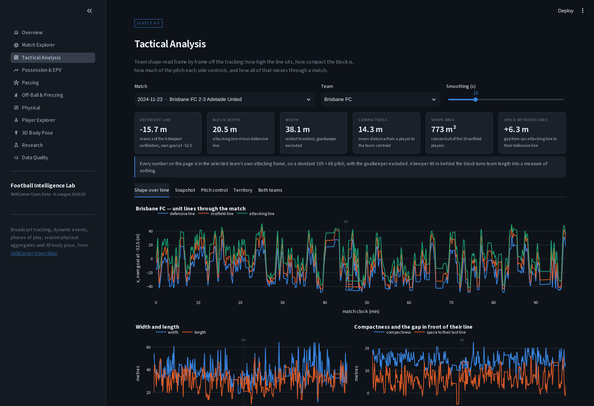
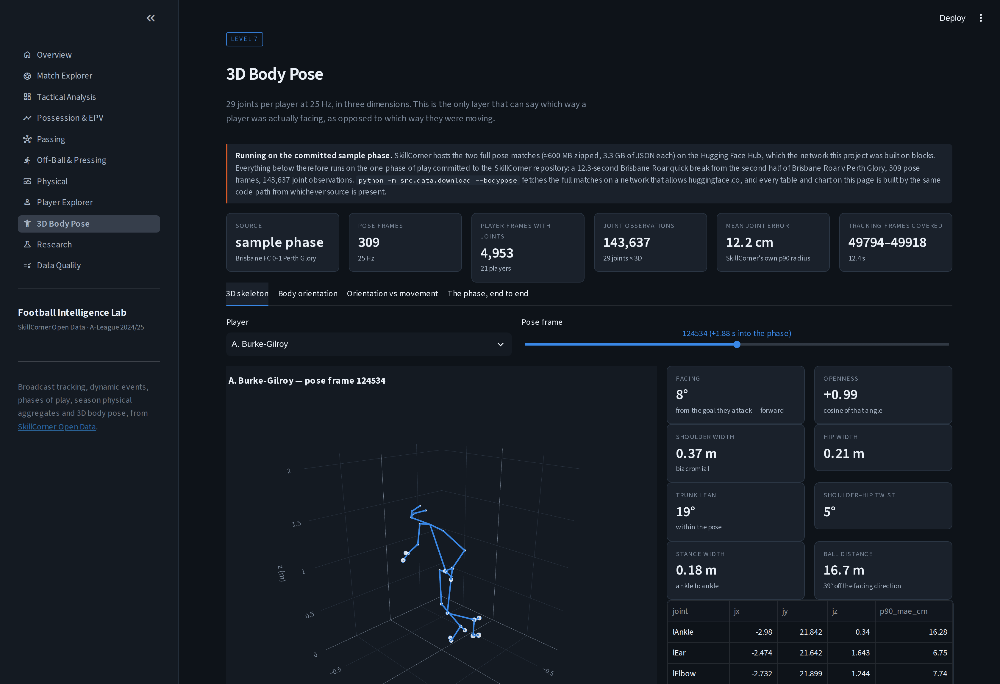
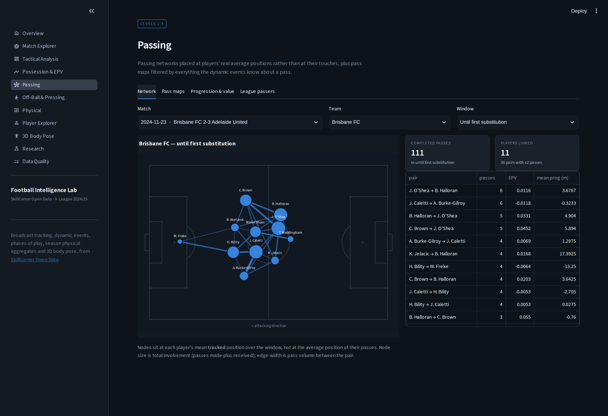
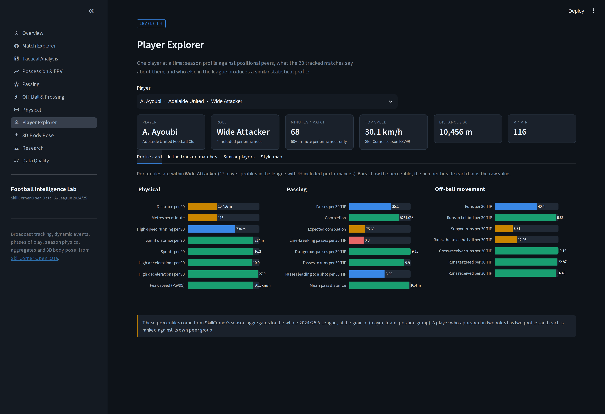

<h1 align="center">Football Intelligence Lab</h1>

<p align="center">
  <em>An open-source football analytics platform combining broadcast tracking,<br>
  dynamic events, physical performance and 3D body pose.</em>
</p>

<p align="center">
  <a href="#quick-start">Quick start</a> ·
  <a href="#the-question-ladder">The ladder</a> ·
  <a href="#what-the-data-actually-says">Findings</a> ·
  <a href="#architecture">Architecture</a> ·
  <a href="docs/METHODOLOGY.md">Methodology</a> ·
  <a href="docs/LIMITATIONS.md">Limitations</a>
</p>

---

Most football dashboards answer *what happened*. This one is built to answer
**why**, by putting four independent layers of the same match on a single clock:

| layer | what it knows | rows |
|---|---|---:|
| Dynamic events | possessions, passes, off-ball runs, pressing, EPV, pressure | 94,517 |
| Broadcast tracking | 22 players and the ball, 10 Hz | 19,334,986 |
| Phases of play | what both teams were doing, concurrently | 8,874 |
| Season physical | distance, high-speed running, PSV99 for the whole league | 406 |
| 3D body pose | 29 joints per player, 25 Hz, in three dimensions | 143,637 |

20 matches of the 2024/25 Australian A-League, from
[SkillCorner Open Data](https://github.com/SkillCorner/opendata).

<p align="center">
  
</p>

---

## Quick start

```bash
git clone <this repository>
cd football-intelligence-lab

pip install -r requirements.txt

python -m src.data.download        # ~1.9 GB: metadata, events, phases, tracking
python -m src.pipeline             # build every analytical table (~15 min)
streamlit run app/main.py
```

`python -m src.data.download --bodypose` additionally fetches the two full 3D
pose matches (~1.2 GB) from the Hugging Face Hub. The pose pages work without
it, on the phase of play committed to the SkillCorner repository — see
[Limitations](#limitations).

Rebuild only part of the pipeline:

```bash
python -m src.pipeline --steps features models research
python -m src.pipeline --force            # rebuild everything from raw
python -m pytest                          # 120 tests, ~60 s
```

> The tracking files are stored with Git LFS. `git clone` of the SkillCorner
> repository leaves 133-byte pointer files behind and `git lfs pull` needs
> credentials on some networks, so `src/data/download.py` fetches the resolved
> payload over plain HTTPS from `media.githubusercontent.com` instead.

---

## The question ladder

The application is organised as a climb. Each rung needs data the rung below
cannot see, and each has its own page.

| | question | what answers it | page |
|---|---|---|---|
| **L1** | What happened? | dynamic events | Possession & EPV |
| **L2** | Where did it happen? | event coordinates — once you know they are stored in each team's *attacking* frame, not the broadcast's | Match Explorer |
| **L3** | Who else was there? | 22 players at 10 Hz | Match Explorer |
| **L4** | Why did it happen? | pressure, space, defensive lines, pitch control | Tactical Analysis |
| **L5** | What happened away from the ball? | off-ball runs, team shape, post-turnover response | Off-Ball & Pressing |
| **L6** | What did it cost? | tracking-derived load, cross-checked against SkillCorner | Physical |
| **L7** | What was the body doing? | 29 3D joints — which way a receiver was *facing*, not just moving | 3D Body Pose |

---

## What the data actually says

Ten questions, run over the full dataset by `python -m src.research.questions`.
Every number below is read out of `reports/research/`; none is transcribed by
hand, and the null result is included.

**Pressure breaks completion, not value.** Pass completion falls monotonically
from 93.6% unpressured to 64.3% under very high pressure (ρ = −0.220,
n = 11,461). EPV added does *not*: it **peaks at medium pressure** (+0.0028) and
only turns negative at the extreme. Players find their most valuable passes when
they are being pressed but not swarmed.

**SkillCorner's pressure bands are real.** Distance to the nearest opponent —
computed here from tracking, and never an input to their model — runs
11.8 → 7.1 → 4.9 → 2.8 → 1.3 m across the five bands.

**Transitions are worth 7× a build-up possession.** Transition chains average
+0.0309 EPV and 48 m of territory and end in a shot 23% of the time; build-up
averages +0.0045 EPV and −0.1 m. Together, transitions and quick breaks are
under 4% of all possessions.

**Which way a receiver faces is worth 8.4 m.** Across 6,007 receptions by a
moving player, receiving while facing the opposition goal gains +6.5 m against
−1.9 m facing your own, and leads to a shot 16.3% of the time against 2.7%
(Kruskal–Wallis H = 2,650). The gap survives inside every pressure band.
Causation is not established, and the write-up says so.

**Losing the ball while stretched costs less, not more.** Across 5,147
turnovers, teams that lose possession in their loosest shape concede 12.6 m in
the next 8 s versus 15.8 m for the most compact, and the opponent holds the ball
3.2 s less. A stretched shape is mostly a team committed high up the pitch, and
the counter-press that follows is what shortens the opponent's possession.

**Support runs are the least-found valuable movement.** Of ten off-ball run
types, cross-receiver runs carry the highest xThreat (0.104). Runs that break
the defensive line are 1.9× as likely to end in a shot.

**Two independent pipelines agree on who is fast.** This project's
tracking-derived PSV99 correlates with SkillCorner's own season figure at
r = 0.58 across 186 players, reading 5.1 km/h lower — expected, since theirs is a
season-level percentile from their full pipeline and this is 1–3 matches of
broadcast frames after conservative smoothing.

**3D pose confirms the movement-heading proxy.** On 4,953 player-frames,
pose-derived torso facing and tracking movement heading agree to a median of
9.0° above 4 m/s (95% within 45°) and diverge to 68.7° below 1 m/s. That
gradient is what licenses the orientation analysis above at scale — and it also
proves the shoulder-rotation sign is right, since an inverted construction would
sit near 180°.

**A null result, reported as one.** Once ball position is controlled for, this
project's pitch-control model does *not* predict how far a team moves the ball
over the next five seconds (|ρ| < 0.08 in every third of the pitch, n = 1,992).
Taken raw the correlation looks like −0.21, which is a ceiling artefact: a ball
near the goal has nowhere left to travel. The methodological lesson is in
[`docs/METHODOLOGY.md`](docs/METHODOLOGY.md#6-pitch-control--this-projects-model-not-skillcorners).

---

## The thing that was nearly wrong

Dynamic-event and phase-of-play coordinates are stored in the **attacking frame
of the row's own team**. Tracking is in **broadcast orientation**, which flips at
half time. Nothing upstream says so.

Joining the two naively produced a median position error of **9.2 m** and a 90th
percentile of **80 m** — half of every event overlay was a mirror image, and it
looked plausible enough on a pitch plot to survive a glance. After correcting
for it the same measurement is **0.00 m**, and it is asserted in both directions
in the test suite:

```python
# tests/test_clock_and_orientation.py
assert flipped.median() < 0.01                 # the flip must be exact
assert np.hypot(neg.x_start - neg.x, ...).median() > 20   # and necessary
```

Six similar source quirks — four matches with no EPV at all, `xThreat` living on
a different event type than you would expect, an event player missing from a
team sheet — are catalogued in
[`docs/DATA_DICTIONARY.md §8b`](docs/DATA_DICTIONARY.md) and pinned by tests.

---

## Architecture

```
raw JSON/CSV/JSONL  →  validation  →  normalisation  →  features  →  DuckDB  →  Streamlit
```

```
football-intelligence-lab/
├── app/
│   ├── main.py                    # st.navigation entry point
│   ├── pages/                     # 11 pages, one per rung of the ladder
│   ├── components/                # cached data access, UI primitives
│   └── styles/app.css
├── src/
│   ├── config.py                  # every path, threshold and colour
│   ├── pipeline.py                # `python -m src.pipeline`
│   ├── data/                      # download, loaders, DuckDB warehouse, pose streaming
│   ├── preprocessing/             # tracking → Parquet, events → Parquet, validation
│   ├── tracking/                  # kinematics engine, pitch-control model
│   ├── events/                    # possessions, chains, passes, pressures, transitions
│   ├── features/                  # team shape, physical, networks, body pose
│   ├── models/                    # player similarity
│   ├── research/                  # the ten research questions
│   ├── visualization/             # Plotly theme, pitch plots, charts, 3D pose
│   └── utils/pitch.py             # four coordinate spaces, zones, geometry
├── notebooks/                     # six executed exploratory notebooks
├── tests/                         # 120 tests
├── docs/                          # data dictionary, methodology, analytics, limitations
└── reports/                       # validation report, research artefacts
```

**Storage.** Raw JSONL is parsed exactly once. Everything downstream reads
Parquet (~1 GB, zstd), with DuckDB views over it for predicate-pushdown slicing —
pulling the 300 frames an animation needs out of a 44 MB file takes
milliseconds. The app caches per match and per table.

**Performance.** A full rebuild from raw takes about 15 minutes: 9 s per match
for tracking with kinematics, 24 s per match for per-frame team shape at 10 Hz.
A pitch-control surface is 3 ms. The 19.3 M-row tracking table never enters the
app whole.

---

## The application

| page | what it is for |
|---|---|
| **Overview** | the dataset, and the ladder |
| **Match Explorer** | one moment, from all four sources: 22 players, the ball, both phases of play, the event record, a pitch-control surface, and the ±5 s around it |
| **Tactical Analysis** | unit lines, width, length, compactness, hull area, space between the lines, territory, control maps |
| **Possession & EPV** | possession chains end to end, EPV rankings by player and team, value by phase and by pressure |
| **Passing** | networks placed on real tracked positions, filterable pass maps, completion against SkillCorner's expected completion |
| **Off-Ball & Pressing** | ten run types by threat and by how often they are found, pressing chains, the 8 s after every turnover |
| **Physical** | load by intensity zone, sprints, accelerations, in/out of possession split, and a cross-check against SkillCorner's own pipeline |
| **Player Explorer** | percentile card against positional peers, tracked-match detail, cosine-similarity neighbours, PCA style map |
| **3D Body Pose** | interactive 3D skeletons, body orientation on the pitch, and the pose-vs-heading validation |
| **Research** | the ten questions, with the evidence tables behind them |
| **Data Quality** | every validation check, per match, including the ones that failed |

<p align="center">
  
  
</p>
<p align="center">
  
  
</p>

Screenshots are captured from the running application by
`python scripts/capture_screenshots.py`.

---

## Methodology in one screen

Full detail in [`docs/METHODOLOGY.md`](docs/METHODOLOGY.md). The parts that most
affect the numbers:

**Kinematics.** Positions are placed on a full frame grid, gaps up to 1 s
bridged, then a 2nd-order Savitzky–Golay filter over a 1.3 s window is fitted per
segment; velocity and acceleration are the filter's analytic derivatives.
Acceleration is *tangential* — the component along the direction of travel — so a
hard turn at constant pace is not counted as an acceleration. Implausible values
are **masked, not clipped**: clipping quietly adds a plausible 12 m/s to a
distance total. On a synthetic 6 m/s track with 5 cm of noise this recovers
6.001 ± 0.043 m/s; raw differencing gives ±0.7.

**Coordinates.** Four spaces — raw, standard (105 × 68), attacking, and
tracking-joinable — with the conversion between them stored as `attack_sign` on
every row.

**Pitch control.** This project's model, not a SkillCorner metric, and labelled
that way everywhere it appears. Two parameters (0.7 s reaction, 8 m/s), a
time-to-intercept softmax, and a documented failure mode.

**Derived metrics** invented here carry a `fil_` prefix in the data so they can
never be mistaken for SkillCorner measurements. Everything SkillCorner provides —
EPV, pressure bands, xThreat, run classifications — is used exactly as delivered
and never recomputed.

---

## Limitations

The short version; the full list is [`docs/LIMITATIONS.md`](docs/LIMITATIONS.md).

- **Broadcast tracking sees ~73% of a match.** 27% of frames carry nothing, and
  44% of player positions are extrapolations rather than observations. No
  distance here is a match total, and every physical row carries `coverage` and
  `detected_frac` so it can be read correctly.
- **Player identity is ~97% accurate** by SkillCorner's own statement, and this
  project cannot verify it: the file is extrapolated, so identity errors are
  smoothed into continuous tracks rather than left as visible jumps.
- **EPV, pressure and reception difficulty are absent from 4 of 20 matches** —
  3,829 of 18,792 possessions. Undocumented upstream, pinned by a test, and
  reported in the app.
- **The full 3D pose matches could not be downloaded.** SkillCorner hosts them
  on Hugging Face, which the build network blocks. The pose work runs on the
  committed sample phase (12.3 s, 4,953 player-frames with joints). The loader
  streams a full match archive out of its zip when one is present, so nothing
  needs changing to scale up.
- **20 matches, one league, one season, no causal claims.**

---

## Testing

```bash
python -m pytest          # 120 tests in ~60 s
```

| suite | what it protects |
|---|---|
| `test_pitch.py` | coordinate transforms, zones, geometry, round-trips |
| `test_kinematics.py` | constant-velocity and constant-acceleration recovery, gap handling, masking vs clipping, effort detection, that a turn is not an acceleration |
| `test_clock_and_orientation.py` | the match clock against all three source files; the event-orientation fact, asserted in both directions |
| `test_pipeline.py` | table keys, joins, reconciliation between grains, physiological plausibility, and the source quirks |
| `test_pitch_control.py` | symmetry, antisymmetry, monotonicity in velocity, edge cases |
| `test_features.py` | opponent-frame flipping, network node placement, pose orientation at six known angles, and the real-data pose-vs-heading check |
| `test_app.py` | all 11 pages render against the real tables, plus every branch behind the main selectors |

---

## Data and credit

All data is **[SkillCorner Open Data](https://github.com/SkillCorner/opendata)**,
released by [SkillCorner](https://skillcorner.com) in partnership with
[PySport](https://pysport.org/) under the terms in that repository. Broadcast
tracking, dynamic events, phases of play, season aggregates and 3D body pose are
all theirs; if you use this project, credit SkillCorner.

Nothing in this repository is affiliated with or endorsed by SkillCorner. Metrics
invented here are prefixed `fil_` and labelled as this project's own wherever
they appear.

---

## What I would build next

- **The full pose matches.** Every pose analysis here is limited by 12 seconds of
  data, not by the code. Two full matches would turn the orientation study from a
  proxy validated on pose into a study done in pose.
- **Orientation as a causal question.** The 8.4 m gap needs a design that
  separates body shape from game state — matched pairs on phase, pressure and
  field position, or an instrument for why a player happened to be turned.
- **A calibrated pitch-control model.** Fit arrival times to observed
  interceptions instead of assuming 8 m/s for everyone, then re-run the
  progression question that came back null.
- **Off-ball runs against pitch control.** SkillCorner labels the runs; control
  says what space each run created. Joining them would measure the value of a
  run nobody passed to.
- **Multi-season similarity.** 237 player profiles from one season is thin for a
  style model; the same code scales to any number of seasons of aggregates.
